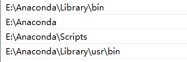

# 第一章：Anaconda 安装与环境配置（Windows）

本教程面向第一次接触 Python 的同学，适用于 64 位 Windows 10/11。完成后，你将能够使用 Conda 创建独立的 Python 环境，并通过命令行运行课程代码。

> 说明：本教程中的“环境变量”主要指 Windows 的系统 `Path`。课程要求先把 Anaconda 安装到非 C 盘，再手动加入所需目录，最后使用 `conda init` 完成终端初始化。

## 1. 下载 Anaconda

1. 打开 [Anaconda 官方下载页面](https://www.anaconda.com/download)。
2. 下载 Windows 64 位图形安装程序（文件扩展名为 `.exe`）。
3. 下载完成后双击安装程序。

请只从官网或可信镜像站下载安装包，不要从不明网盘下载。

## 2. 安装 Anaconda

按照安装向导操作：

1. 点击 **Next**。
2. 阅读并接受许可协议。
3. 安装类型选择 **Just Me**，只为当前用户安装。
4. 安装目录不要选择 C 盘。请选择空间充足的 D、E、F 等其他磁盘，例如：

   ```text
   D:\Anaconda
   ```

   安装在哪个盘都可以，但路径尽量只使用英文字母和数字，不要包含中文、空格或特殊符号。请记住自己的实际安装目录，后面配置环境变量时会用到。

5. 进入 **Advanced Installation Options** 时保留默认设置。
6. 不要勾选 **Add Anaconda3 to my PATH environment variable**。
7. 点击 **Install**，等待安装完成。

这里不使用安装程序自动修改 Path，而是在安装完成后手动添加课程需要的目录。这样可以确认每一条路径都指向自己的实际安装位置。

## 3. 验证安装

安装完成后，从 Windows 开始菜单打开 **Anaconda Prompt**，依次执行：

```bat
conda --version
python --version
where conda
where python
```

正常情况下：

- `conda --version` 会显示 Conda 版本号。
- `python --version` 会显示 Python 版本号。
- `where conda` 和 `where python` 会显示 Anaconda 安装目录中的文件路径。

还可以执行下面的命令查看 Anaconda 已安装的软件包：

```bat
conda list
```

## 4. 配置 Windows 系统环境变量

课程要求把 Anaconda 的相关目录手动加入系统 `Path`。系统变量会影响这台电脑上的所有用户，修改时通常需要管理员权限；不要删除或覆盖 Path 中原有的项目。

### 4.1 确认自己的安装目录

下面以安装到 `E:\Anaconda` 为例。你的电脑可能安装在 D、E、F 等其他磁盘，必须换成自己的实际安装目录。

先在文件资源管理器中打开安装目录，确认下面这些文件夹是否存在：

```text
E:\Anaconda
E:\Anaconda\Scripts
E:\Anaconda\Library\bin
E:\Anaconda\Library\usr\bin
```

不同 Anaconda 版本的目录可能略有区别。只添加电脑上真实存在的目录；不存在的目录不要填写。

### 4.2 打开系统 Path

1. 按 Windows 键，搜索“环境变量”。
2. 打开“编辑系统环境变量”。
3. 在“系统属性”的“高级”选项卡中点击“环境变量”。
4. 在下方“系统变量”区域找到 `Path`。
5. 选中 `Path`，点击“编辑”。
6. 不要删除列表中已有的内容。

### 4.3 添加4条路径

点击“新建”，逐条加入下面4个目录。假设你的安装目录是 `E:\Anaconda`：

```text
E:\Anaconda\Library\bin
E:\Anaconda
E:\Anaconda\Scripts
E:\Anaconda\Library\usr\bin
```



如果安装在 `D:\Anaconda`，则应改成：

```text
D:\Anaconda\Library\bin
D:\Anaconda
D:\Anaconda\Scripts
D:\Anaconda\Library\usr\bin
```

关键规则是：4条路径的开头必须全部是你自己的 Anaconda 安装目录，不能直接照抄别人的盘符。

添加完成后，连续点击“确定”保存所有窗口。然后关闭之前打开的 CMD、PowerShell 和 Anaconda Prompt，再重新打开 CMD。

### 4.4 验证环境变量

在新打开的 CMD 中依次执行：

```bat
conda --version
python --version
where conda
where python
```

检查结果：

- `conda --version` 和 `python --version` 应显示版本号。
- `where conda` 应指向你的 Anaconda 安装目录。
- `where python` 的第一条结果应指向你的 Anaconda 安装目录。

如果仍提示无法识别 `conda`：

1. 检查4条路径有没有拼写错误。
2. 检查使用的是“系统变量”中的 `Path`。
3. 确认相关目录在电脑上真实存在。
4. 完全关闭终端后重新打开；必要时重启电脑。
5. 打开 Anaconda Prompt，并继续完成下一节的 `conda init`。

## 5. 初始化普通终端

配置好系统 Path 后，打开 **Anaconda Prompt** 并执行：

```bat
conda init
```

执行完成后：

1. 关闭所有命令提示符、PowerShell 和 Anaconda Prompt 窗口。
2. 重新打开需要使用的终端。
3. 执行 `conda --version` 验证。

在 Windows 上，不指定终端类型的 `conda init` 会初始化命令提示符和 PowerShell。以后执行 `conda activate 环境名` 时，Conda 会临时调整当前终端的 Path，并运行必要的激活脚本。

## 6. 创建课程专用环境

不要长期在 `base` 环境里安装所有课程依赖。为课程创建一个名为 `smartclub` 的独立环境：

```bat
conda create -n smartclub python=3.11 numpy
```

终端询问是否继续时，输入 `y` 并按回车。

创建完成后激活环境：

```bat
conda activate smartclub
```

看到命令行开头出现 `(smartclub)`，说明环境已经激活。然后检查当前 Python：

```bat
python --version
where python
```

退出当前环境：

```bat
conda deactivate
```

## 7. 最基本的 Conda 命令

| 命令 | 作用 |
| --- | --- |
| `conda --version` | 查看 Conda 版本 |
| `python --version` | 查看当前 Python 版本 |
| `conda info` | 查看 Conda 安装和当前环境信息 |
| `conda env list` | 查看所有 Conda 环境，星号表示当前环境 |
| `conda create -n smartclub python=3.11` | 创建名为 `smartclub` 的环境 |
| `conda activate smartclub` | 激活 `smartclub` 环境 |
| `conda deactivate` | 退出当前环境 |
| `conda install numpy` | 在当前环境安装 NumPy |
| `conda list` | 查看当前环境安装的软件包 |
| `conda update -n base conda` | 更新 base 环境中的 Conda |
| `where python` | 查看当前实际使用的 Python 路径 |

每次安装软件包前，先确认命令行开头显示的是正确环境名称。

## 8. 配置清华大学 Anaconda 镜像源

网络访问默认源较慢时，可以按照清华大学开源软件镜像站的当前说明配置镜像。

这项配置只影响 `conda` 下载软件包，不会改变 `pip` 的下载源。

### 8.1 生成配置文件

在 Anaconda Prompt 中执行：

```bat
conda config --set show_channel_urls yes
```

Windows 的 Conda 配置文件位于：

```text
C:\Users\你的用户名\.condarc
```

### 8.2 备份并打开配置文件

先备份原配置：

```bat
copy "%USERPROFILE%\.condarc" "%USERPROFILE%\.condarc.bak"
```

然后用记事本打开：

```bat
notepad "%USERPROFILE%\.condarc"
```

把文件内容替换为：

```yaml
channels:
  - defaults
show_channel_urls: true
default_channels:
  - https://mirrors.tuna.tsinghua.edu.cn/anaconda/pkgs/main
  - https://mirrors.tuna.tsinghua.edu.cn/anaconda/pkgs/r
  - https://mirrors.tuna.tsinghua.edu.cn/anaconda/pkgs/msys2
custom_channels:
  conda-forge: https://mirrors.tuna.tsinghua.edu.cn/anaconda/cloud
  pytorch: https://mirrors.tuna.tsinghua.edu.cn/anaconda/cloud
```

保存并关闭记事本。

### 8.3 清除旧索引并验证

执行：

```bat
conda clean -i
conda config --show-sources
conda config --show default_channels
```

输出中出现 `mirrors.tuna.tsinghua.edu.cn`，说明配置已经被 Conda 读取。

然后创建课程环境，实际测试下载：

```bat
conda create -n smartclub python=3.11 numpy
```

如果 `smartclub` 环境已经创建，则执行：

```bat
conda activate smartclub
conda install numpy
```

下载信息中的 Channel URL 应指向清华镜像站。

## 9. 运行第一章代码

激活课程环境：

```bat
conda activate smartclub
```

切换到课程文件所在目录后运行：

```bat
python ch01_入门与环境.py
```

如果程序显示 `Hello, Python!` 并提示输入名字，就说明环境已经可以正常使用。

## 参考资料

- [Conda：Windows 安装说明](https://docs.conda.io/projects/conda/en/latest/user-guide/install/windows.html)
- [Conda：管理和激活环境](https://docs.conda.io/projects/conda/en/stable/user-guide/tasks/manage-environments.html)
- [Conda：conda init 命令](https://docs.conda.io/projects/conda/en/latest/commands/init.html)
- [清华大学开源软件镜像站：Anaconda 使用帮助](https://mirrors.tuna.tsinghua.edu.cn/help/anaconda/)
