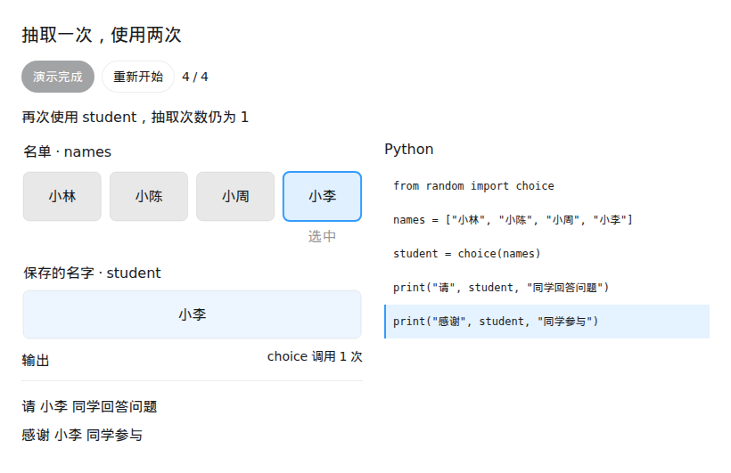
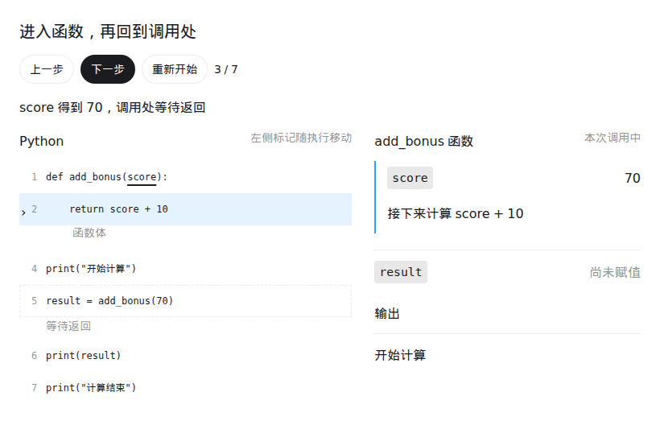
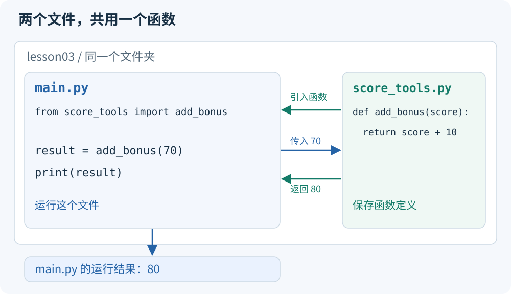

# 第 3 周：函数与模块

[课程目录](../README_上学期.md) · [← 上一周：第 2 周](./第02周_数据结构与条件循环.md) · [下一周：第 4 周 →](./第04周_文件异常与类.md)

随机点名需要一份名单，也需要从名单中选出一个名字的方法。Python 已经提供了随机选择函数，可以直接用于这个任务。

在本教程中，我们将先运行一个随机点名程序，学习如何给函数提供数据、接收函数的结果；随后编写自己的计算函数，观察调用时的执行过程；最后将函数保存在独立文件中，供其他程序使用。

## 预备：创建并运行 Python 文件

### 1. 创建工作文件

在电脑中选择一个便于查找的位置，创建文件夹 `lesson03`。使用已经配置好 Python 的编辑器打开这个文件夹，新建文件，并以 `roll_call.py` 为文件名保存在其中。下面的代码需要自行输入或复制到这个文件中。

Python 源代码通常保存在扩展名为 `.py` 的文本文件中。

### 2. 运行第一行代码

在 `roll_call.py` 中输入以下代码，保存文件，使用编辑器的 Python 运行功能运行当前文件：

```python
print("你好，Python！")  # 显示括号中的文字；两侧的引号不显示
```

也可以在 `lesson03` 文件夹中打开终端，执行 `python roll_call.py`。使用 `python3` 启动 Python 的环境，对应命令为 `python3 roll_call.py`。

**运行结果**

```text
你好，Python！
```

引号中的文字称为字符串。将它改为 `"准备开始点名"`，保存并重新运行，输出也会变为这段文字。后续每次修改代码，都需要保存并重新运行，才能看到新的结果。

输入代码时，括号、引号、逗号和冒号使用英文半角符号，字符串内部可以写中文。

## 一、使用函数完成随机点名

现在的程序只能显示固定文字。接下来，我们将准备一份名单，使用随机选择函数选出一个名字，再用选中的名字生成点名提示。

### 1. 在程序中保存名单

将 `roll_call.py` 的内容整体替换为以下代码，保存并运行：

```python
# 方括号组成列表；每个名字是一个元素，元素之间用逗号分隔
names = ["小林", "小陈", "小周", "小李"]  # 将列表赋给变量 names
print(names)  # 通过 names 取得这份名单，显示整个列表
```

**运行结果**

```text
['小林', '小陈', '小周', '小李']
```

输出包含列表中的四个名字。变量 `names` 保存这份名单，后面可以通过它指定抽取范围。

### 2. 调用随机选择函数

将 `roll_call.py` 的内容整体替换为以下代码，保存并运行：

```python
from random import choice  # 引入本例需要的随机选择函数

names = ["小林", "小陈", "小周", "小李"]
# choice 是函数名，括号中的 names 是传入的参数，提供抽取范围
student = choice(names)  # 调用函数，将返回的名字保存到 student
print(student)          # 显示 student 保存的名字
```

**运行结果（一次示例）**

```text
小周
```

这次输出的是名单中的一个名字，由 `choice` 函数随机选出。再次运行程序会重新抽取，名字可能改变，也可能与上次相同。

`choice(names)` 是一次**函数调用**：通过函数名指定要使用的功能，通过括号中的**参数**提供要处理的数据。函数交回调用处的结果称为**返回值**。

以刚才输出“小周”为例，程序将整份名单传给 `choice`，得到返回值 `"小周"`，再将这个值赋给 `student`。参数提供抽取所需的数据，返回值则是这次抽取的结果。

### 3. 使用选中的名字

抽取结果已经保存在 `student` 中，可以继续用它生成点名提示。将 `roll_call.py` 末尾的 `print(student)` 替换为两条输出语句。修改后的完整代码如下，保存并运行：

```python
from random import choice

names = ["小林", "小陈", "小周", "小李"]
student = choice(names)              # 抽取一次，保存选中的名字
print("请", student, "同学回答问题")  # 使用保存的名字
print("感谢", student, "同学参与")    # 再次使用这个名字
```

**运行结果（一次示例）**

```text
请 小周 同学回答问题
感谢 小周 同学参与
```

两条提示中的名字相同，因为它们使用了同一次抽取保存的结果。

`print` 可以接收多项内容，默认用空格将它们隔开，因此名字与前后文字之间各有一个空格。两条输出语句都使用 `student`，不会再次调用 `choice`。

**交互演示：[抽取一次，使用两次](./demos/week03/random-choice.html)**

下载 HTML 文件后，用浏览器打开。点击“下一步”，观察名字如何被选出、保存到 `student`，再用于两条输出；点击“重新开始”可以再次抽取。

[](./demos/week03/random-choice.html)

### 练习：更换名单并使用抽取结果

在当前的 `roll_call.py` 中完成以下修改：

1. 将名单改成三个其他名字。
2. 在文件末尾增加一条提示，例如“下一题仍由 小周 回答”，其中的名字使用变量 `student`。
3. 保存并运行，检查三条提示是否使用同一个名字，以及这个名字是否属于新名单。

## 二、编写自己的函数

已经定义好的函数可以直接调用。对于自己需要的处理，也可以定义一个函数，再用相同的方式调用它。

接下来，我们将编写一个计算函数：接收一个分数，返回加上 10 后的结果。

### 1. 定义并调用加分函数

保留 `roll_call.py`。在同一个 `lesson03` 文件夹中新建 **`score_bonus.py`**，输入以下完整代码，保存并运行这个新文件：

```python
# def 开始定义函数；括号中写参数，末尾加冒号
def add_bonus(score):  # score 接收传入的分数
    return score + 10  # 函数体缩进四个空格；返回加十分后的结果

result = add_bonus(70)  # 传入 70，将返回的 80 保存到 result
print(result)          # 显示 80
```

**运行结果**

```text
80
```

`add_bonus(70)` 返回了 `80`，变量 `result` 接收到这个值，最后由 `print` 显示。

缩进在函数定义下方的语句组成**函数体**。这里的函数体只有一行；后面的赋值和打印语句回到不缩进的位置，属于函数外的代码。

在定义中，`score` 是接收数据的参数。调用 `add_bonus(70)` 时，`score` 接收到 `70`，所以 `score + 10` 的结果是 `80`。`return` 将这个值交回调用处，并结束本次函数执行。

### 2. 函数体的范围

函数体可以包含多条语句。下面将加分过程拆成“设置加分值、计算新分数、返回结果”三个步骤。将 `score_bonus.py` 的内容替换为以下代码，保存并运行：

```python
def add_bonus(score):
    bonus = 10                 # 函数体：设置加分值
    new_score = score + bonus   # 函数体：计算新分数
    return new_score           # 函数体：返回计算结果

result = add_bonus(70)  # 回到不缩进的位置，已经在函数体外
print(result)          # 这条打印语句也在函数体外
```

**运行结果**

```text
80
```

结果仍然是 `80`。这次函数体包含三条语句，它们都比 `def` 所在行向右缩进四个空格，从 `bonus = 10` 开始，到 `return new_score` 结束。

`result = add_bonus(70)` 和 `print(result)` 与 `def` 左端对齐，属于函数外的代码。因此，调用 `add_bonus(70)` 时执行的是缩进的三个步骤，返回结果后，再由函数外的语句接收并打印。

### 3. 用不同的数据调用

保留 `score_bonus.py` 中的函数定义，将它下面的调用和输出语句改为以下内容，然后保存并运行：

```python
result = add_bonus(70)  # 这次 score 接收 70，返回 80
print(result)

result = add_bonus(85)  # 这次 score 接收 85，返回 95，result 保存新的结果
print(result)
```

**运行结果**

```text
80
95
```

两次调用使用同一套计算方法，分别处理两个分数。函数只需定义一次，就可以在调用时提供不同的数据，多次使用。

### 练习：改变计算规则

将函数中的 `bonus = 10` 改为 `bonus = 5`，保留两次调用。保存并运行，输出应依次为 `75` 和 `90`。

两次调用都会使用修改后的计算规则。完成后，将加分规则恢复为加 `10`，保存文件，供后面的实验使用。

## 三、函数在什么时候执行

前面的程序中，函数定义写在最上方，调用写在它的下方。为了观察函数体何时执行，我们将在调用前后各显示一条提示。

将 `score_bonus.py` 的内容整体替换为以下代码，保存并运行：

```python
def add_bonus(score):   # 建立函数，函数体等待调用时执行
    return score + 10   # ③ score 为 70；计算并返回 80，结束本次调用

print("开始计算")      # ① 显示开始提示
result = add_bonus(70)  # ② 调用函数；④ 将返回的 80 赋给 result
print(result)          # ⑤ 显示 result 保存的值
print("计算结束")      # ⑥ 显示结束提示
```

**运行结果**

```text
开始计算
80
计算结束
```

第一条输出是“开始计算”。程序执行函数定义时，会建立这个函数；执行到调用语句时，才进入函数体完成计算。

调用发生时，程序进入函数体；函数返回后，程序回到调用处，完成赋值，再继续执行后面的语句。

**交互演示：[进入函数，再回到调用处](./demos/week03/function-call.html)**

下载 HTML 文件后，用浏览器打开。点击“下一步”，观察 `70` 如何传给 `score`、`80` 如何返回并赋给 `result`，以及程序如何继续输出。点击“上一步”可以回看前一步的状态，点击“重新开始”可以从头演示。

[](./demos/week03/function-call.html)

### 练习：连续调用两次

在 `print("计算结束")` 前面增加一次 `add_bonus(85)` 的调用，将结果保存到变量并打印。先判断输出顺序，再保存并运行程序验证。

## 四、显示结果与返回结果

目前的函数使用 `return` 返回计算结果，函数外使用 `print` 显示结果。为了观察两者的区别，接下来只改变函数内部处理结果的方式。

### 1. 在函数内部打印

将 `score_bonus.py` 的内容替换为以下代码，保存并运行：

```python
def add_bonus(score):
    print(score + 10)  # 在函数内部显示 80，产生第一行输出
                      # 函数执行到末尾，没有 return，返回 None

result = add_bonus(70)             # 接收返回值 None
print("接收到的结果：", result)   # 显示 result，因此第二行包含 None
```

**运行结果**

```text
80
接收到的结果： None
```

第一行的 `80` 由函数内部的 `print` 显示。这个函数没有使用 `return` 返回计算结果，因此调用结束时返回 `None`，变量 `result` 接收到的也是 `None`。

### 2. 将结果返回给调用处

在当前文件中，仅把函数内部的 `print(score + 10)` 改为 `return score + 10`。修改后的完整代码如下，保存并重新运行：

```python
def add_bonus(score):
    return score + 10  # 返回 80；return 本身不显示内容

result = add_bonus(70)             # 接收返回值 80
print("接收到的结果：", result)   # 在这里显示结果，整个程序只输出一行
```

**运行结果**

```text
接收到的结果： 80
```

`return` 将结果交回调用处，外面的代码可以保存它、显示它，也可以继续计算。

### 练习：继续使用计算结果

保留返回结果的版本，在文件末尾增加下面两行代码，保存并运行：

```python
next_result = result + 5
print("再加五分：", next_result)
```

输出的最后一行应为 `再加五分： 85`。这次计算使用了函数返回并保存在 `result` 中的数值。

## 五、独立编写和使用函数

接下来，我们将分别完成一个计算任务和一个点名任务。每题都需要在 `lesson03` 文件夹中新建文件，并写成能够独立运行的程序。参考解答放在文末。

### 练习一：将分钟换算为秒

新建 `time_tools_practice.py`，编写函数 `to_seconds(minutes)`，接收分钟数，返回对应的秒数。换算关系为：1 分钟等于 60 秒。

先在文件中写好函数定义，再在下方加入以下调用语句，保存并运行：

```python
seconds = to_seconds(3)
print(seconds)

seconds = to_seconds(5)
print(seconds)
```

**预期输出**

```text
180
300
```

编写时，分别确定参数接收什么、函数体做什么计算、`return` 返回什么。显示结果的语句已经写在函数外。

### 练习二：为两个班级点名

重新打开 `roll_call.py`，查看其中的随机选择语句。接下来，将“接收名单、选择名字、返回名字”写成自己的函数，让两个班级分别调用它。

在 `lesson03` 文件夹中新建 `class_roll_call.py`，编写函数 `pick_name(names)`：

- 参数 `names` 接收一份名单。
- 函数内部调用 `choice(names)`，随机选出一个名字。
- 使用 `return` 返回选中的名字。

在文件开头写入 `from random import choice`，在它下方编写函数定义，最后加入以下调用代码。保存并运行 **`class_roll_call.py`**：

```python
class_a = ["小林", "小陈", "小周"]
class_b = ["小李", "小王", "小赵"]

student_a = pick_name(class_a)
student_b = pick_name(class_b)
print("一班：请", student_a, "同学回答问题")
print("二班：请", student_b, "同学回答问题")
```

**运行结果（一次示例）**

```text
一班：请 小陈 同学回答问题
二班：请 小王 同学回答问题
```

检查每个名字是否来自对应班级。两次调用都使用函数中的参数 `names`：第一次接收一班名单，第二次接收二班名单。

## 六、模块：使用其他文件中的函数

前面的程序已经使用了 `choice`，也定义了 `add_bonus` 和 `pick_name`。这些函数既可以写在调用它们的文件中，也可以组织在其他文件中，通过导入使用。

### 1. 认识随机选择函数的来源

最初的点名程序通过这一行代码引入 `choice`：

```python
from random import choice
```

现在重新打开 **`roll_call.py`**，将内容整体替换为下面的写法，保存并运行：

```python
import random  # 导入 random 模块

names = ["小林", "小陈", "小周", "小李"]
student = random.choice(names)       # 使用 random 模块中的 choice 函数
print("请", student, "同学回答问题")
```

**运行结果（一次示例）**

```text
请 小周 同学回答问题
```

程序仍然完成了一次点名，随机选择函数的导入方式和调用写法发生了变化。

**模块**用于组织相关的 Python 代码。`random` 是 Python 自带的模块，提供随机选择等功能。

两种导入方式都能使用同一个 `choice` 函数，但调用时写法不同：

| 导入语句 | 对应的调用写法 |
| --- | --- |
| `from random import choice` | `choice(names)` |
| `import random` | `random.choice(names)` |

`from random import choice` 将 `choice` 这个名称引入当前代码，可以直接调用；`import random` 引入模块名称，调用时通过点号指定其中的函数。

### 2. 把自己的函数保存到模块中

加分函数也可以保存在单独的文件中，供其他程序导入。接下来，我们将使用已经熟悉的 `add_bonus` 完成这个过程。

保留之前的文件，在 `lesson03` 文件夹中新建 **`score_tools.py`** 和 **`main.py`**。两个新文件必须保存在同一个文件夹中。

在 `score_tools.py` 中输入以下完整代码并保存：

```python
def add_bonus(score):  # 在这个文件中定义函数
    return score + 10
```

在 `main.py` 中输入以下完整代码并保存：

```python
from score_tools import add_bonus  # 从 score_tools.py 中引入 add_bonus
                                  # 导入语句中的模块名不带 .py
result = add_bonus(70)             # 调用引入的函数，接收计算结果
print(result)
```

运行 **`main.py`**。使用终端时，在 `lesson03` 文件夹中执行 `python main.py`，或使用对应的 `python3 main.py`。

**运行结果**

```text
80
```

输出仍然是 `80`，但函数定义和调用已经分布在两个文件中。`score_tools.py` 是一个自定义模块，保存计算方法；运行的 `main.py` 提供分数、调用函数并显示结果。



`from score_tools import add_bonus` 与前面的 `from random import choice` 使用相同的导入形式；区别在于一个模块由我们编写，另一个由 Python 提供。

### 练习：通过模块名调用

保留 `score_tools.py`，修改 `main.py`：

1. 将导入语句改为 `import score_tools`。
2. 将调用改为 `score_tools.add_bonus(70)`。
3. 保存并运行 `main.py`，检查输出是否仍为 `80`。
4. 再增加一次调用，计算 `85` 加分后的结果并显示。

## 拓展练习：让加分值也能改变（选做）

此前的 `add_bonus` 每次都加 10。如果不同任务需要加不同的分数，可以把加分值也作为参数。

在 `lesson03` 文件夹中新建 `flexible_bonus.py`，输入以下代码，保存并运行：

```python
def add_bonus(score, bonus):  # 两个参数用逗号分隔
    return score + bonus     # 使用本次调用提供的分数和加分值

result = add_bonus(70, 10)    # 70 传给 score，10 传给 bonus
print(result)

result = add_bonus(70, 5)     # 70 传给 score，5 传给 bonus
print(result)
```

**运行结果**

```text
80
75
```

这种调用写法按位置对应参数：第一个值对应第一个参数，第二个值对应第二个参数。

在文件末尾增加一次调用，计算 `85` 加 `3` 后的结果。保存并运行，最后一行应为 `88`。

## 课后查阅

### 核心写法

```python
def add_bonus(score):   # 定义函数；score 接收传入的数据
    return score + 10   # 函数体缩进；return 返回计算结果

result = add_bonus(70)  # 调用函数；将返回值保存到 result
print(result)          # 显示保存的结果
```

| 要完成的事情 | 写法 |
| --- | --- |
| 从模块中引入函数 | `from score_tools import add_bonus` |
| 调用引入的函数 | `add_bonus(70)` |
| 导入整个模块 | `import score_tools` |
| 通过模块名称调用函数 | `score_tools.add_bonus(70)` |

### 练习参考解答

以下代码供完成练习后对照。需要运行时，将完整解答写入对应练习文件；模块练习需要同时保留 `score_tools.py`。

#### 更换名单并使用抽取结果

对应文件：`roll_call.py`。这是第一节练习的一种完整写法，名单可以换成其他名字。

```python
from random import choice

names = ["小吴", "小郑", "小孙"]
student = choice(names)
print("请", student, "同学回答问题")
print("感谢", student, "同学参与")
print("下一题仍由", student, "回答")  # 使用同一次抽取保存的名字
```

#### 连续调用两次

对应文件：`score_bonus.py`。这是第三节练习完成后的完整版本。

```python
def add_bonus(score):
    return score + 10

print("开始计算")
result = add_bonus(70)
print(result)
result = add_bonus(85)  # 再次进入函数，score 接收到 85
print(result)
print("计算结束")
```

输出依次为“开始计算”、`80`、`95`、“计算结束”。

#### 将分钟换算为秒

对应文件：`time_tools_practice.py`。

```python
def to_seconds(minutes):
    return minutes * 60  # 计算秒数并返回

seconds = to_seconds(3)
print(seconds)

seconds = to_seconds(5)
print(seconds)
```

#### 为两个班级点名

对应文件：`class_roll_call.py`。

```python
from random import choice

def pick_name(names):
    student = choice(names)  # 从这次接收的名单中选择一个名字
    return student          # 将选中的名字返回给调用处

class_a = ["小林", "小陈", "小周"]
class_b = ["小李", "小王", "小赵"]

student_a = pick_name(class_a)  # names 接收一班名单
student_b = pick_name(class_b)  # names 接收二班名单
print("一班：请", student_a, "同学回答问题")
print("二班：请", student_b, "同学回答问题")
```

#### 通过模块名调用

`score_tools.py` 保留如下内容：

```python
def add_bonus(score):
    return score + 10
```

`main.py` 修改为：

```python
import score_tools

result = score_tools.add_bonus(70)
print(result)

result = score_tools.add_bonus(85)
print(result)
```

运行 `main.py`，输出依次为 `80` 和 `95`。

### 复习题

1. 在 `student = choice(names)` 中，函数接收的是什么数据，返回的是什么数据？
2. 为什么两条输出语句使用同一个 `student`，能够显示同一个名字？
3. 定义 `add_bonus` 时，函数体会立即进行计算吗？什么时候开始计算？
4. 执行 `result = add_bonus(85)` 时，`score` 和 `result` 分别得到什么值？
5. 将函数中的 `return score + 10` 改成 `print(score + 10)` 后，为什么输出出现了 `None`？
6. 函数定义移到 `score_tools.py` 后，`main.py` 如何使用这个函数？
