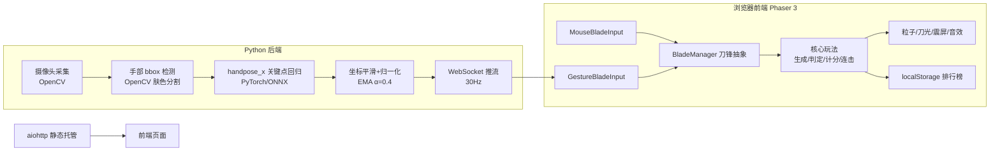

## 产品概述

> 2026-09-14 实现说明：本文件保留原始规划。当前运行引擎已替换为 MediaPipe Tasks，
> 不再依赖肤色分割与 handpose_x 权重。已补齐可调出刀方式、摄像头骨架预览、运行中设置、
> 摄像头自动重连、鼠标兜底、轨迹防误切及自动化联调。无尽规则沿用现有实现的 5 次机会。
> 双人对战仍按本规划保留扩展接口，不纳入本期。准确运行方式与验证边界见根目录 README.md / TESTING.md。

一款用于社团招新宣传的**手势识别切水果小游戏**：线下展台场景中，玩家在摄像头前挥动手臂即可切开屏幕上的水果，同时保留鼠标操作选项作为备用输入。画面炫酷、上手零门槛，用于吸引人流驻足体验。

## 核心功能

- **手势切水果**：摄像头捕捉手部 → 手部关键点检测 → 手指位置映射为"刀锋"轨迹，挥动切水果
- **鼠标交互保留**：手势/鼠标输入可随时切换，统一抽象为刀锋输入
- **两种玩法模式**：无尽模式（3 次失误机会）、限时模式（60 秒倒计时）
- **演示模式**：无人操作时屏幕自动演示切水果，吸引展台人流
- **本地排行榜**：游戏结束输入昵称，localStorage 保存本机 Top10
- **炫酷视觉**：水果弹射、果汁粒子飞溅、刀光拖尾、连击反馈、屏幕震动、程序生成音效
- **双人对战预留**：本期不做，输入层架构预留多路刀锋扩展点

## 技术栈

- **Python 后端（手势识别）**：Python 3.8 + OpenCV（摄像头采集与手部 bbox 检测）+ PyTorch（handpose_x 21 关键点推理，可选 ONNX/onnxruntime 加速）+ websockets（推流）+ aiohttp（托管静态前端）
- **前端游戏**：Phaser 3.60+（CDN 引入，免构建）+ 原生 HTML/CSS/ES6 模块
- **数据持久化**：localStorage（本地排行榜）
- **音效**：Web Audio API 程序合成，零版权资源

## 系统架构



## 实现方案

### 后端（backend/）

- **手部检测抽象**：`Detector` 接口 + `OpenCVSkinDetector` 默认实现（YCrCb 肤色分割 + 最大连通域 + bbox 转正方形放大 1.1 倍，与 handpose_x 官方预处理一致），预留 MediaPipe 检测器扩展点
- **关键点引擎**：`HandposeEngine` 加载 handpose_x 模型（PyTorch 优先，模型缺失时降级 ONNX/报错不崩溃）；取**食指指尖（点8）**映射刀锋位置，配置可切换掌心
- **推流协议**：JSON `{x, y, visible, ts}`，坐标归一化 0~1；检测不到手时 `visible=false`，前端刀锋淡出避免误触
- **性能**：采样频率默认 30Hz；EMA 指数平滑降低抖动；肤色检测失败直接跳过推理（省 CPU）
- **一键启动**：`start.bat` 检查依赖后启动 `main.py`（默认端口 8000），自动打开浏览器，同一端口托管静态前端（规避 CORS 与多端口问题）

### 前端（frontend/）

- **场景划分**：BootScene（预生成纹理）→ MenuScene（模式/输入选择）→ GameScene（核心玩法）→ ResultScene（得分+昵称+排行榜）
- **输入抽象**：`BladeInput` 接口（`getPosition/isActive/onMove`），`MouseBladeInput` 与 `GestureBladeInput`（WebSocket 客户端，含断线重连与 visible 门控）统一接入 `BladeManager`，天然支持多路刀锋（双人对战预留）
- **核心玩法**：水果/炸弹按概率生成、抛物线弹道、对象池复用；刀锋以"上一帧-当前帧线段"做圆碰撞检测；ComboSystem 短窗口连击倍率；无尽/限时两种规则引擎
- **视觉**：Phaser Particles 果汁飞溅与碎片、刀光拖尾、camera shake、连击文字弹跳、炸弹爆炸慢动作
- **水果素材**：Canvas 程序生成径向渐变球体+高光，零图片资源

## 目录结构

```
新建文件夹/
├── backend/
│   ├── main.py               # [NEW] 入口：组装启动 WebSocket + 静态托管
│   ├── config.py             # [NEW] 配置：端口/摄像头ID/fps/模型路径/平滑参数
│   ├── hand_detector.py      # [NEW] Detector 抽象 + OpenCV 肤色检测实现
│   ├── handpose_engine.py    # [NEW] handpose_x 模型加载与推理（PyTorch/ONNX 双模式）
│   ├── gesture_server.py     # [NEW] WebSocket 推流 + EMA 平滑 + 归一化 + 静态托管
│   └── models/               # [NEW] 存放用户下载的 handpose_x 预训练权重（百度网盘）
├── frontend/
│   ├── index.html            # [NEW] 游戏入口页
│   ├── css/style.css         # [NEW] 菜单/排行榜/HUD 覆盖层样式
│   └── js/
│       ├── main.js           # [NEW] Phaser 配置与场景注册
│       ├── scenes/           # [NEW] Boot/Menu/Game/Result 四个场景
│       ├── core/             # [NEW] FruitSpawner/Slicer/ComboSystem/BladeManager
│       ├── input/            # [NEW] BladeInput 接口 + Mouse/Gesture 实现
│       ├── effects/          # [NEW] 粒子/刀光/音效（Web Audio 合成）
│       └── net/              # [NEW] GestureClient（WebSocket 客户端）
├── start.bat                 # [NEW] Windows 一键启动（含依赖检查）
├── requirements.txt          # [NEW] opencv-python/numpy/torch/websockets/aiohttp
└── README.md                 # [NEW] 模型下载、运行、排错说明
```

## 关键代码结构

```typescript
// 前端输入抽象（双人对战预留多路）
interface BladeInput {
  id: string;
  getPosition(): { x: number; y: number };
  isActive(): boolean;        // visible 门控，防误触
  onMove(cb: (pos: { x: number; y: number }) => void): void;
}
// 后端推流消息
type GestureMsg = { x: number; y: number; visible: boolean; ts: number };
```

## 风险与降级

- **模型缺失**：handpose_x 权重需用户从百度网盘下载（README 密码 99f3）放入 `backend/models/`；缺失时后端返回 `model_missing`，前端提示并自动切鼠标模式，演示模式不受影响
- **手部检测鲁棒性**：肤色检测受光线影响，提供亮度自适应阈值与检测器可插拔接口，README 给出展台布光建议
- **延迟**：本机回环 WebSocket 延迟可忽略；推理帧率可配置，必要时降为 20Hz 保流畅

## 设计风格

面向展台大屏的**霓虹水果派对**风格：深色渐变星空背景衬托高饱和水果色，霓虹发光刀光与果汁粒子形成强烈视觉冲击。整体动效丰富（连击放大、屏幕震动、慢动作），远距离即可吸引人流，近距离上手即玩。

## 页面规划

- **主菜单**：大标题"疯狂切水果"霓虹字效 + 社团 Logo 位，模式选择卡（无尽/限时/演示）、输入方式切换（手势/鼠标）、排行榜入口；背景为缓慢漂浮的霓虹粒子
- **游戏主界面**：全屏 Canvas 游戏区，HUD 顶部悬浮（分数/连击/机会或倒计时/输入模式指示），半透明玻璃面板；刀光为霓虹渐变拖尾
- **结算页**：得分数字滚动动画、连击统计、昵称输入框、Top10 排行榜表格（当前名次高亮），"再来一局/返回菜单"
- **引导提示**：首次进入显示"挥动你的手切水果！"大字动画，配合手势示意图

## 视觉规范

深色底 + 霓虹高光 + 高饱和水果色点缀，所有面板半透明玻璃拟态 + 霓虹描边；按钮悬停发光上浮；关键反馈（连击/失误）使用大字号弹跳动画。

## Agent Extensions

### Skill

- **Impeccable（前端设计工具集）**
- Purpose: 用于设计游戏前端界面（主菜单、排行榜、HUD 覆盖层）的视觉样式与交互细节，确保展台画面炫酷、专业、非模板化
- Expected outcome: 产出高完成度的菜单/结算/排行榜界面样式与动效方案，落地为 index.html + style.css 中的具体实现

### SubAgent

- **code-explorer**
- Purpose: 探索 handpose_x 仓库代码结构，核实模型加载、输入预处理（归一化/尺寸）、输出关键点索引等推理接口细节，避免集成时接口猜测错误
- Expected outcome: 确认 handpose_engine.py 中模型加载与推理的正确调用方式，输出集成要点
